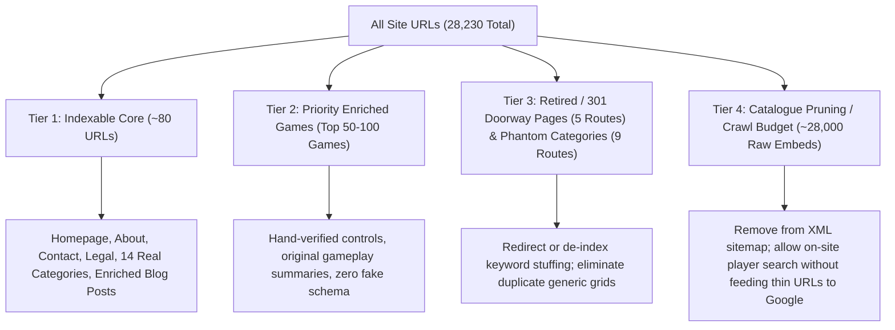

# Phase 1 — Comprehensive Content & Page Inventory Audit Report
**BrowserGames100.com — Inventory, Quality Metrics & Content Remediation Classification**
*Audit Script Executed: `scripts/audit-inventory.cjs`*  
*Date of Audit: October 24, 2026*

---

## 1. Inventory & Quantitative Findings

Our automated scanning across all 364 local data files, TypeScript definitions, routing tables, and live server responses produced the following empirical baseline:

| Content Element | Total Records | Confirmed Quality Findings |
| :--- | :--- | :--- |
| **Total Game Catalogue** | **28,154 games** | 100% GameMonetize embeds (`html5.gamemonetize.com`: 26,357; `html5.gamemonetize.co`: 1,797). |
| **Game Descriptions Quality** | **28,154 scanned** | **27,586 games (98%) have truncated descriptions** that cut off mid-sentence without terminal punctuation (e.g. `"...in this captivating digital en"`). |
| **Game Instructions Quality** | **28,154 scanned** | **5,628 games (20%) have generic 4-word instructions** (e.g. `"Mouse click to play"` or `< 15` characters). |
| **Genre & Category Pages** | **23 categories** | **9 categories (39%) are phantom/broken**: `browser-games`, `strategy-games`, `simulation-games`, `idle-games`, `kids-games`, `2-player-games`, `html5-games`, `no-download-games`, and `instant-games` lack data JSON files and fall back to the exact same 48 generic games. |
| **Doorway Landing Pages** | **5 routes** | `/play-html5-games`, `/free-browser-games`, `/cloud-gaming-unblocked`, `/poki-alternative`, `/unblocked-racing-games` serve thin text with 3 aggressive ad units and repeat the same 20 initial games. |
| **Blog & Editorial Posts** | **49 articles** | Average length: **174 words per article** (thin overview snippets); stock Unsplash photography; synthetic future dates (`2026-09-30`); persona author names without verified credentials. |
| **Crawler Visible Content** | **All 28k routes** | **Pure Client-Side Rendering (CSR)** delivers an empty `

` shell with the homepage title and description to any non-JavaScript crawler or review bot. |
| **Sitemap Mass Submission** | **1 index + 4 sub-sitemaps** | `sitemap-games.xml` is **5.2 MB**, submitting all 28,154 thin, truncated game URLs directly to Google Search. |

---

## 2. In-Depth Evaluation by URL Type

### 2.1 Homepage (`/`)
- **Template**: `src/pages/Index.tsx`
- **Unique User Value**: High navigational hub for browsing games, genres, and trending picks.
- **Accuracy & Originality**: Low-to-Medium. Aggregates distributor games.
- **Confirmed Policy & SEO Violations**:
  - Fabricated stats: "2M+ Players", "4.9 Rating", "United States: 840K+ users", "United Kingdom: 210K+ users".
  - Untrue claims: "Every title is hand-tested for performance, safety, and age-appropriateness before going live" and "100% safe for students".
  - Leftover copied brand contact: `support@cloudplayhub.com` in Schema.org `Organization`.
  - Right-click blocker: `ScraperShield.tsx` disables browser context menu for all users.
  - Duplicate brand name in `<title>`: `BrowserGames100 — Free Browser Games, No Download Needed | BrowserGames100`.

### 2.2 Category & Genre Pages (`/category/:slug` & `/categories`)
- **Templates**: `src/pages/CategoryPage.tsx`, `src/pages/CategoriesPage.tsx`
- **Unique User Value**:
  - **14 Valid Categories** (Action, Puzzle, Arcade, Racing, Shooting, Sports, Multiplayer, Fighting, Girls, Hypercasual, Clicker, .IO, 3D, Adventure): High discovery value when backed by real game files.
  - **9 Phantom Categories**: Zero value. These routes (`/category/browser-games`, `/category/html5-games`, `/category/no-download-games`, `/category/instant-games`, `/category/strategy-games`, `/category/simulation-games`, `/category/idle-games`, `/category/kids-games`, `/category/2-player-games`) falsely claim 28,450 games in `categories.json`, fail to load a category file, and silently duplicate the initial 48 games.
- **AdSense Impact**: Extreme risk. Search raters and crawlers inspecting category pages encounter mass duplicate grids and keyword-stuffed pseudo-categories.

### 2.3 Programmatic Doorway Pages (`/play-html5-games`, `/poki-alternative`, etc.)
- **Template**: `src/pages/LandingPage.tsx`
- **Unique User Value**: Extremely low.
- **Google Spam Policy Violation**: Doorway pages designed solely to rank for query permutations ("poki alternative", "cloud gaming unblocked", "play html5 games"). Each page embeds 3 separate leaderboard ads (`728x90`) around thin 100-word blurbs and identical game lists.
- **Action**: Must be de-indexed (`noindex, follow`) or retired with 301 redirects to canonical category hubs.

### 2.4 Game Detail Pages (`/game/:slug`)
- **Template**: `src/pages/GamePage.tsx` (28,154 routes)
- **Unique User Value**: High potential as playable games, but currently near-zero editorial value.
- **Identified Failure Points**:
  - **98% truncated distributor descriptions** cut off mid-word.
  - **20% generic instructions** ("Mouse click to play").
  - **Fake AggregateRating**: Hardcoded 4.8 star rating and fabricated rating count of 100 on every unrated game.
  - **Canned FAQPage Schema**: Generic non-game-specific questions and answers repeated 28,154 times.
  - **Zero Server-Side HTML**: Crawlers fetching the URL receive `

` with homepage meta tags.
- **Action**: Stop mass-indexing the entire uncurated 28k catalogue. Isolate an indexable tier of verified, top-performing games enriched with genuine controls, real objectives, and clean metadata.

### 2.5 Blog & Editorial Guides (`/blog` & `/blog/:slug`)
- **Templates**: `src/pages/BlogList.tsx`, `src/pages/BlogPost.tsx` (49 posts)
- **Unique User Value**: Moderate. Helpful topics (Chromebook unblocked guides, retro game reviews).
- **Identified Failure Points**:
  - Short length (average 174 words per post; essentially brief listicles).
  - Persona authors ("Marcus Vance", etc.) without real bio/credential pages.
  - Fixed future dates (`2026-09-30`) indicating automated scheduling.
  - Stock Unsplash imagery without direct gameplay screenshots.

### 2.6 Trust, Policy & Utility Pages (`/about`, `/contact`, `/privacy`, `/terms`, `/disclaimer`, `/dmca`, `/favorites`, `/search`)
- **Templates**: Dedicated pages in `src/pages/`
- **Identified Failure Points**:
  - `/about`: Claims "2M+ Monthly Players" and an extensive manual testing process that does not exist in code.
  - `/contact`: Submits to `/api/submissions/contact`. If the Node.js backend is unreachable or disabled, the form fails with an error and provides no fallback email address.
  - `/favorites` & `/search`: Client utility pages currently lacking explicit `noindex` directives, creating crawl bloat risks.

---

## 3. Four-Tier Content Remediation Classification

To comply with Google AdSense Site Readiness and Search Spam Policies without destroying valid functionality, every URL type is classified into one of four action tiers:

### Tier 1: Immediate Indexable Core
*Priority: High — Immediate Remediation*
- **Homepage** (`/`)
- **14 Valid Category Pages** (`/category/action-games`, `puzzle-games`, `arcade-games`, `racing-games`, `shooting-games`, `sports-games`, `multiplayer-games`, `fighting-games`, `girls-games`, `hypercasual-games`, `clicker-games`, `io-games`, `3d-games`, `adventure-games`)
- **Categories Hub** (`/categories`)
- **Trust & Legal Pages** (`/about`, `/contact`, `/privacy`, `/terms`, `/disclaimer`, `/dmca`)
- **Editorial Hub** (`/blog`) & High-Quality Guides
- **Required Fixes**: Sanitize claims, remove fake metrics, fix contact email, remove right-click block, fix duplicate title tags.

### Tier 2: Priority Enriched Games
*Priority: High — Quality First Approach*
- Identify the top 50 to 100 most popular/playable games (e.g. Slope, Run 3, Retro Bowl, Drift Hunters, 1v1.LOL, 2048, Fireboy and Watergirl).
- Enrich these priority titles with:
  - Verified controls (WASD, Arrow keys, Touchscreen, Mouse).
  - Clear objective and rules written in original text.
  - Tested beginner tips and level strategies.
  - Device and browser compatibility facts.
  - Verified developer and source attribution.
  - 100% policy-compliant `VideoGame` schema (no fake `AggregateRating`, no canned `FAQPage`).

### Tier 3: Doorway & Phantom Pages (Retire or Redirect)
*Priority: Immediate — Elimination of Spam Signals*
- **5 Doorway Landing Pages**:
  - `/free-browser-games` → 301 redirect to `/`
  - `/poki-alternative` → 301 redirect to `/`
  - `/cloud-gaming-unblocked` → 301 redirect to `/`
  - `/unblocked-racing-games` → 301 redirect to `/category/racing-games`
  - `/play-html5-games` → 301 redirect to `/category/action-games` or set `noindex, follow`
- **9 Phantom Categories**:
  - Remove from `public/data/categories.json` navigation.
  - If requested directly, set `noindex, follow` or 301 redirect to closest valid category.

### Tier 4: Catalogue Pruning (Crawl Budget & Low-Value Removal)
*Priority: Essential for AdSense Approval*
- **Remove 28,154 raw distributor embeds from `sitemap-games.xml`**.
- The games will remain 100% playable for on-site users via instant search and category navigation, but the website will **stop presenting 28,000 thin, truncated, identical-shell pages to Google's indexing and AdSense review bots**.
- Only Tier 2 enriched games will be included in the public game sitemap.

---

## 4. Automated Warnings vs. Human Editorial Actions

| Issue Flag | Tooling Status | Action Required | Responsible Specialist |
| :--- | :--- | :--- | :--- |
| **AdSense Pub-ID Mismatch** | Automated Warning | Confirm whether `pub-7316477328258550` or `pub-3506447122776682` is active account. | User Checkpoint |
| **Exposed Secrets in `server/.env`** | Automated Warning | Move MySQL credentials to `.env.example` and untrack from git. | Engineering |
| **Right-Click Block (`ScraperShield.tsx`)** | Automated Warning | Remove `contextmenu` preventDefault listener. | Engineering & Accessibility |
| **Fake Schema (`AggregateRating`)** | Automated Warning | Strip hardcoded ratings and canned FAQ schema from `GamePage.tsx`. | Technical SEO |
| **Phantom Category Data Files** | Automated Warning | Clean `categories.json` to 14 confirmed datasets. | Full-Stack Engineer |
| **Doorway Page De-indexing** | Automated Warning | Add `noindex` or 301 redirects to doorway routes. | Technical SEO |
| **Homepage Claims Sanitization** | Human Editorial | Replace "2M+ players" and "hand-tested" with verified platform descriptions. | Editorial Lead |
| **About Us Policy Transparency** | Human Editorial | Accurately describe curation methodology, contact SLA, and platform role. | Policy Specialist |
| **Priority Game Controls Verification** | Human Editorial | Document tested keys and touchscreen compatibility for top 50 games. | QA Game Engineer |

---

## 5. Next Steps — Transition to Phase 2

With the comprehensive inventory complete, Phase 1 establishes the exact files and parameters requiring remediation. Phase 2 will execute the removal of low-value and deceptive content:
1. Reconcile AdSense publisher ID with user confirmation.
2. Sanitize homepage and about page claims (remove fake stats, fake ratings, and unverified student safety guarantees).
3. Disable context-menu blocking in `ScraperShield.tsx`.
4. Fix `categories.json` by removing phantom categories.
5. De-index or redirect the 5 doorway landing pages.
6. Strip fake structured data from `GamePage.tsx`.
7. Move plaintext database credentials out of tracked repository files.
